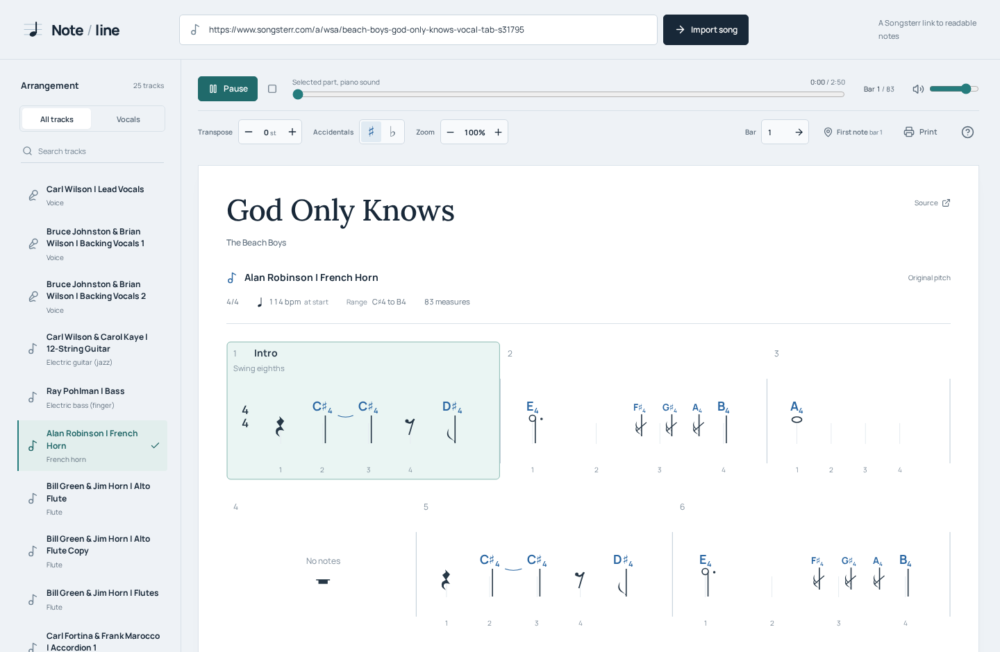
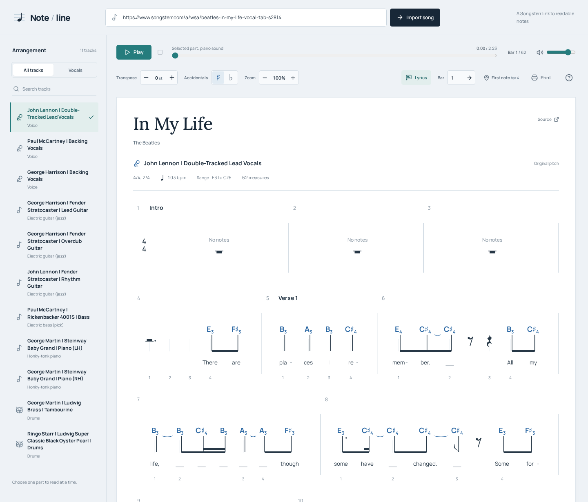
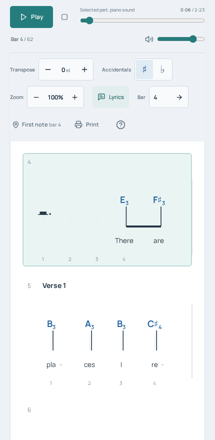

# Note / line

Turn a Songsterr track into readable letter notes, with octave labels, rhythm, and lyrics aligned to the melody. Listen to the selected part while the current bar is highlighted.



## Read a song

1. Paste a Songsterr song link and click **Import song**, or click **Try God Only Knows**.
2. Choose an instrument or voice in **Arrangement**. Filter by **Vocals** or search for a track. On mobile, open **Tracks** first.
3. Click **First note** to skip opening rests, then **Play** to hear the selected part. Use **Bar** to jump elsewhere.

Each letter is a pitch; the number is its octave (`C4` is middle C). Stems and beams show rhythm, stacked notes form chords, and rest symbols mark silence. Open **How to read this notation** for the reading key.

Use **Transpose**, **Accidentals**, and **Zoom** to adjust the score. Toggle **Lyrics** when the source includes them, or **Print** to save a clean PDF. Playback uses piano sounds for pitched parts and percussion sounds for drums.

## Lyrics and mobile views

<details>
<summary>Vocal score with aligned lyrics</summary>

*In My Life* by The Beatles, with John Lennon's double-tracked lead vocals selected. Syllables sit beneath their notes; hyphens split words and underlines continue a syllable.



</details>

<details>
<summary>Reading on a phone</summary>

The same vocal track after jumping to its first note in bar 4.



</details>

## Run locally

With [Bun 1.4.2](https://bun.com) installed:

```bash
bun install
bun run dev
```

Open <http://localhost:4813>. Vite serves the frontend and proxies `/api` to the Bun server on port `3001`.

For production, stop the dev server and run:

```bash
bun run prod
```

This builds and serves the app on port `4813`. Override it with `PORT=4814 bun run prod`, or bind locally with `HOST=127.0.0.1 bun run prod`.

## Open directly from Songsterr

1. Copy [`scripts/songsterr-note-line.user.js`](scripts/songsterr-note-line.user.js) into a new Tampermonkey script.
2. Set `SERVER_URL` near the top to your running app's address, such as `http://localhost:4813/`, and save.
3. On Songsterr, click **Read letter notes** below the song title to import the current track.

## Development

Built with Bun, Vite, React 19, and TypeScript.

```bash
bun run typecheck
bun run test
bun run build
```

See [Songsterr conversion](docs/songsterr-conversion.md) for pitch, rhythm, and support limits.
